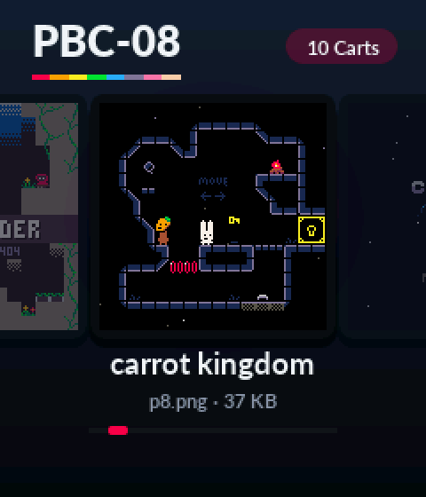

# PBC-08

Inoffizieller PICO-8-kompatibler Player für den **PicoBoy Color Plus** (RP2350A, 520 KB RAM, 16 MB
Flash, ST7789 240×280, PWM-Lautsprecher). VM: [fake-08](https://github.com/jtothebell/fake-08)
(MIT) von jtothebell mit z8lua, angepasst an 520 KB RAM. Der Name PBC-08 verneigt sich
vor fake-08: „PBC“ statt „fake“, die „08“ bleibt.

PICO-8 ist eine Marke von Lexaloffle Games. PBC-08 ist ein inoffizielles,
unabhängiges Projekt ohne Verbindung zu Lexaloffle und enthält keine
Software von Lexaloffle.

## Benutzung

1. `dist/pbc_pico8.uf2` flashen (BOOTSEL halten, USB anstecken, Datei kopieren).
2. Erster Start (leeres Laufwerk), **A/B beim Einschalten halten** oder die
   Karte „USB-Stick“ im Menü: USB-Laufwerk „PICO8“. Carts (`.p8`, `.p8.png`,
   auch in Unterordnern) draufkopieren, **auswerfen** – startet neu.
3. Cart-Menü: links/rechts blättern (läuft rund), hoch/runter springt 5 weiter,
   A oder B startet. Am Ende: „Optionen“ (Skalierung, Lautstärke) und „USB-Stick“.

| PICO-8 | PicoBoy |
|---|---|
| Steuerkreuz | Joystick |
| O (Taste 4) | A |
| X (Taste 5) | B |
| Pause | Mitte + A (Mitte allein tut im Spiel nichts) |

**Skalierung** – im Pausenmenü (Mitte + A) Eintrag „scale“ mit links/rechts,
oder im Cart-Menü unter „Optionen“; wird in `pico8.cfg` gespeichert:

* `1:1` – 128×128, mittig
* `240` – 240×240 (nearest neighbour, 15 von 16 Pixeln doppelt)
* `256 crop` – exakt 2×, 256×256, links/rechts je 4 PICO-8-Pixel abgeschnitten

**Spiele aus mehreren Carts** (`load()`): in einen Ordner, der wie die
Haupt-Cart heißt, z. B. `/spiel/spiel.p8.png` plus die Teil-Carts daneben.
Das Menü zeigt den Ordner als eine Karte. `load("#name")` sucht `name.p8`
bzw. `name.p8.png` im selben Ordner.

Spielstände (`cartdata`) liegen in `/cdata`, geänderte werden alle 5 s
geschrieben. Dort liegt auch je Cart ein ROM-Cache (`<nummer>.rom`, 17 KB),
damit das Cart-ROM nicht im RAM bleiben muss; er wird bei Bedarf neu erzeugt.

## Grenzen

* Lua bekommt den freien Heap. Große Carts brechen mit „not enough memory“
  ab und kehren ins Menü zurück (z. B. Touhou Unmei no Hoshi).
* Keine Zeilennummern in Lua-Fehlermeldungen (Debug-Info wird verworfen, spart RAM).
* Keine Maus/Tastatur, kein BBS-Download.
* Rechenleistung: 250 MHz; schwere 60-fps-Carts laufen langsamer.

## Bauen

Braucht das Pico SDK 2.1 (`PICO_SDK_PATH`) und arm-none-eabi-gcc.

    ./build.sh            # -> dist/pbc_pico8.uf2
    ./build.sh clean -DCPU_MHZ=200 -DCPU_VREG=VREG_VOLTAGE_1_15
    ./build.sh -DPBC_SERIAL_LOG=ON   # Log über USB-CDC statt USB-Stick
    tools/flash.sh                   # UF2 auf das BOOTSEL-Laufwerk kopieren
    tools/serial_log.sh              # Log der Debug-Firmware mitschreiben

PC-Test ohne Hardware (Screenshots, Heap-Messung, WAV):

    make -C hosttest && cd hosttest/run && PF_ROOT=. FRAMES=300 SHOTS=299 ../pico8_host cart.p8.png
    HEAP_TOTAL=380000 ...   # ungefähr so knapp wie auf dem Gerät
    make -C hosttest menu_host   # Vorschau des Cart-Menüs (SCREEN=menu|usb|start)
    make -C hosttest label_host luadump_host   # Vorschaubilder prüfen, Lua-Quelltext ausgeben

## Aufbau

* Kern 1: fake-08-VM (eigener 32-KB-Stack), Kern 0: Display-Skalierer + Ton.
* Das Cart-Menü läuft vor der VM; Verlassen eines Spiels startet das Gerät neu ins Menü.
* `src/` Plattform (Display/Tasten/Ton aus PBC Mega Drive, FatFs/USB aus PicoBoyGB,
  Grafik/Schrift des Menüs aus pbcemu).
* `src/memmap_pbc.ld`: Lua-Interpreterkern, Synth und Skalierer laufen aus dem RAM.
* Änderungen an fake-08: Regex/iostream entfernt, Streaming-PNG-Lader (tinfl),
  zeilenweiser .p8-Parser, float-Synth ohne Hall, schlankes Bios, ROM-Cache,
  Speicherbudget mit Notfall-GC, `load()` wie in PICO-8, Skalierung im Pausenmenü.
* Absturzschutz: Watchdog, Hänger-Erkennung und HardFault-Handler; das Menü
  zeigt danach eine Fehlerkarte.

Flash: 0–2 MB Firmware, 2 MB–16 MB FatFs (USB-Laufwerk).

## Lizenzen

Das Gesamtwerk steht unter der **GPL-3.0** (`LICENSE.pbcemu`), weil Menügrafik
(`src/gfx.c`, `src/assets.c`) aus pbcemu stammt. Enthaltene Teile:
fake-08/z8lua MIT (`fake08/LICENSE.MD`), PicoBoyGB-Teile MIT (`LICENSE.picoboygb`),
Lato-Schrift OFL (`LICENSE.lato`), FatFs BSD-artig (`fatfs/`).
